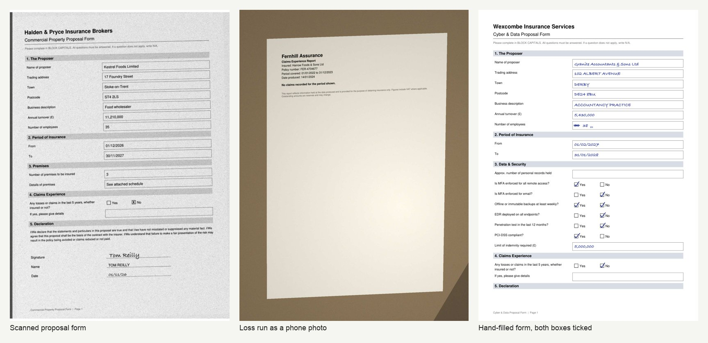

# slipshod

**Messy insurance broking submissions with an answer key. For testing document-AI agents before you trust them with real clients.**



## Try it in 30 seconds

| | |
|---|---|
| **In the browser, no install** | **[ancep.yaqeen.me →](https://ancep.yaqeen.me)** Generate a submission and flip through the documents and traps, download a corpus of up to 100 with answer keys, or score your agent on a 60-submission benchmark. (If nobody has used it for a while, it takes about 15 seconds to wake up.) |
| **One command** (needs [uv](https://docs.astral.sh/uv/)) | `uvx --from git+https://github.com/Abdulmumin1/slipshod slipshod generate corpus -n 30` |
| **The web app on your machine** | `uvx --from "slipshod[app] @ git+https://github.com/Abdulmumin1/slipshod" slipshod app` |
| **Docker** | `docker build -t slipshod https://github.com/Abdulmumin1/slipshod.git && docker run -p 7860:7860 slipshod` |
| **Just look at the files** | [`examples/sample/`](examples/sample/): six submissions with answer keys |

Every team building agents for insurance has the same problem. Real submissions are messy and confidential, so you can't share them, put them in CI, or measure progress on them. Clean synthetic data passes every test and teaches you nothing.

`slipshod` generates renewal submissions the way clients actually send them: a chatty email thread, a spreadsheet that opens on last year's tab, a proposal form that was printed, filled in by hand and scanned crooked, and loss runs where one belongs to a sister company. For every submission it also writes the exact answer a careful broker would reach, plus a list of the traps it planted.

```
$ slipshod generate corpus -n 60 --seed 1 --as-of 2026-11-15
$ python my_agent.py corpus/inputs preds/
$ slipshod score corpus preds/

slipshod score    36.1%   (60 submissions)

  field accuracy        42.7%
  hallucination rate     1.6%   (value given where the documents can't support one)
  location F1           47.4%
  claims F1             48.9%
  flag recall            0.0%

  by difficulty: easy 67.3%   medium 42.1%   hard 23.8%   nightmare 4.8%

  defect survival (worst first)
    claims.sister_company_loss_run       0.0%                       0/23
    sov.stale_tab                        0.0%                       0/6
    form.scanned                         0.0%                       0/25
    ...
    email.stale_forwarded_figures       18.5%  ####                 5/27
```

*(Those numbers come from `slipshod baseline`, a text-layer-and-regex pipeline that scores 93% on clean documents. [`examples/naive_agent.py`](examples/naive_agent.py) is a template for plugging in your own agent.)*

## Why the answer key is the hard part

Making documents look ugly is easy. The hard part is staying honest about what can still be known after the mess. Every planted defect ends in one of three states, and the answer key records which:

| The documents… | Example | The answer key says | A good agent… |
|---|---|---|---|
| **still reveal the truth** | Schedule says £3.9m; a follow-up email says "should be £4.2m, we had a revaluation" | `4200000` | uses the correction |
| **don't contain it at all** | Buildings and contents given as one combined figure | `null` + expected `missing` flag | says it doesn't know, and asks |
| **contradict each other with no tie-breaker** | Form says turnover £5.08m, email says "about £4.67m" | field unscored + expected `conflict` flag | raises it rather than picking silently |

So the scorer can measure what accuracy alone hides:

- **Hallucination rate:** how often the agent fills in a value that the documents can't support.
- **Flag recall:** whether it raised the things a broker would have to chase (unsigned form, three years of loss runs instead of five, "no claims" declared while the loss runs show claims).
- **Defect survival:** for each kind of mess, how often the agent got through untouched. This turns "the agent is 71% accurate" into "the agent falls for stale spreadsheet tabs and can't read hand-ticked boxes".

The generator is built around one rule: **every non-null value in the answer key can be derived from the documents, and every null really can't be.** Tests enforce it. For example, when a site's construction is blanked out, the test checks that it doesn't survive in a duplicate row or last year's tab.

## What's in a submission

```
corpus/
  inputs/SUB-0004/                  <- give this to your agent
    01_re_info_needed_for_your_renewal.eml   (attachments embedded; some submissions add a
                                              02_... "sorry, correction" follow-up)
    attachments/                             (the same files, extracted)
      Kestrel SOV 2026.xlsx
      SCAN_20261115_2874.pdf
      Loss runs Meridian 2021-2025.pdf
      Loss runs Castlegate 2025-2026.pdf
  answers/SUB-0004/                 <- keep this away from it
    answer.json                     the correct extraction, with expected flags
    manifest.json                   every trap planted, where, and which fields it puts at risk
  corpus.json
```

A six-submission sample is checked in at [`examples/sample/`](examples/sample/) if you want to open the files without installing anything.

It covers three lines of business, all UK/GBP: **commercial property** (multi-site schedules of values), **cyber** (security-controls questionnaire) and **marine cargo** (annual open cover). Every submission includes insured details, policy period, proposal form status and a five-year claims history.

To see what was done to a submission:

```
$ slipshod explain examples/sample SUB-0004
Traps:
  - claims.declared_claims_free  (SCAN_20261115_2874.pdf)
      The proposal form ticks 'No claims in 5 years' but the loss runs show claims.
      expect flag: conflict claims
  - claims.open_claims_repeated  (Loss runs Castlegate 2025-2026.pdf)
      Open claims are listed twice: in an 'outstanding claims' summary and again in the full listing.
  - sov.units_thousands  (Kestrel SOV 2026.xlsx)
      Sums insured are stated in thousands; the only hint is '(£000)' in the header.
  - sov.disposed_location  (Kestrel SOV 2026.xlsx)
      A sold site (PE7 7UH) is still in the schedule as a hidden, struck-through row with a 'SOLD' cell comment.
  - form.revenue_conflict  (01_re_info_needed_for_your_renewal.eml)
      The email gives turnover as £12,560,000; the form says £11,210,000. Nothing says which is right.
      expect flag: conflict insured.annual_revenue
  ...

Not scored (genuinely ambiguous): insured.annual_revenue
```

## The defect catalogue

`slipshod defects` lists them all. There are currently 29:

**Spreadsheet (schedule of values)**

| code | what happens |
|---|---|
| `sov.stale_tab` | Workbook opens on last year's tab; the current schedule is the second tab |
| `sov.title_block` | Title rows, merged "Sums Insured" header and blank spacer rows break naive table parsing |
| `sov.single_address_column` | Street, town and postcode in one cell |
| `sov.units_thousands` | Values in £000s; the only clue is the header |
| `sov.money_as_text` | `£1,250,000 `, `1,250,000` and real numbers mixed in one column |
| `sov.mixed_notation` | Sprinklers as ✓/✗, build years like `c. 1965` |
| `sov.disposed_location` | A sold site as a hidden, struck-through row with a "SOLD" comment |
| `sov.duplicate_row` | One site listed twice; the total double-counts it |
| `sov.combined_values` | Buildings + contents as one figure: split unknowable → `missing` flag |
| `sov.missing_construction` | Construction blank / `TBC` → `missing` flag |
| `sov.wrong_total` | Hard-coded TOTAL row that doesn't add up → `conflict` flag |
| `email.sov_correction` | Follow-up email corrects a figure in the schedule |

**Proposal form**

| code | what happens |
|---|---|
| `form.scanned` | Printed, signed, scanned: skew, noise, lid shadow, hole punches, JPEG, no text layer |
| `form.handwritten` | Completed by hand in blue ink, partly in capitals |
| `form.fillable_fields` | Answers live in AcroForm widgets, invisible to `page.get_text()` |
| `form.crossed_out_correction` | Old value struck through, new one written beside it with initials |
| `form.blank_field` | A required answer left blank and given nowhere else → `missing` flag |
| `form.double_ticked` | Both Yes and No ticked → unscored + `conflict` flag |
| `form.unsigned` | Unsigned and undated, though the email calls it signed → `missing` flag |
| `form.revenue_conflict` | Email turnover disagrees with the form → unscored + `conflict` flag |

**Email**

| code | what happens |
|---|---|
| `email.stale_forwarded_figures` | Last year's renewal summary forwarded below, with clean, easy-to-grab old figures |

**Claims history**

| code | what happens |
|---|---|
| `claims.sister_company_loss_run` | A loss run for "Kestrel Holdings Ltd" is attached too; its claims don't count |
| `claims.unreported_recent_claim` | A claim newer than the loss runs, mentioned only in the email body |
| `claims.open_claims_repeated` | Open claims appear in a summary table *and* in the full listing |
| `claims.declared_claims_free` | Form says no claims; loss runs disagree → `conflict` flag |
| `claims.short_loss_run` | Three years of loss runs, not five → `missing` flag |
| `claims.loss_run_missing` | "Loss runs attached." They aren't. Claims are `null` (unknown), not `[]` |
| `lossrun.scanned` | Faxed/scanned loss run |
| `lossrun.phone_photo` | Loss run photographed on a desk: perspective, shadow, one JPEG per page |

Difficulty controls how many defects are planted: `clean` (0), `easy` (1–2), `medium` (3–5), `hard` (6–9) or `nightmare` (all compatible ones). `--only` plants a specific set, which helps when you're working on one failure mode:

```
slipshod generate stale-tabs -n 20 --lines property --only sov.stale_tab,sov.title_block
```

## Plugging in an agent

Your agent reads `inputs/<id>/` and writes `preds/<id>.json`. `slipshod schema` prints the JSON Schema, and `slipshod schema --brief` prints a task brief you can paste into a prompt. The format:

```json
{
  "submission_id": "SUB-0004",
  "insured": {"name": "...", "address": {"line1": "...", "town": "...", "postcode": "..."},
              "trade": "...", "annual_revenue": 11210000, "employees": 35},
  "policy": {"inception_date": "2026-12-01", "expiry_date": "2027-11-30", "currency": "GBP"},
  "proposal_form": {"signed": true, "signed_date": "2026-11-01"},
  "property": {"total_tiv": 26560000, "locations": [ ... ]},
  "claims": [{"date_of_loss": "2024-10-17", "cause": "Escape of water", "insurer": "...",
              "paid": 39550, "reserved": 0, "status": "closed"}],
  "flags": [{"type": "missing", "field": "property.locations[SO15 8NA].construction", "note": "..."}]
}
```

The scorer accepts formats a real agent might produce: `"£1.2m"`, `"01/12/2026"`, postcodes without spaces, names in capitals. It does not accept wrong values. Locations are matched by postcode (falling back to address similarity) and claims by date of loss, so the order doesn't matter.

`slipshod oracle corpus preds/` copies the answer keys into `preds/` as a perfect agent, which is useful for checking your harness. `slipshod score ... -v` lists every miss for each submission, and `--json` writes the full report.

## How it works

```
truth.py     the real risk: insured, sites, controls, insurer history, claims
plans.py     an editable description of each document, initially faithful to the truth
defects.py   each defect edits the plans and records what it did, what's now unknowable,
             and what a broker should flag
render/      plans -> .xlsx (openpyxl), PDF forms and loss runs (PyMuPDF), scans and
             photos (Pillow + NumPy), .eml (stdlib)
score.py     matching, tolerant parsing, hallucination / flag / defect-survival metrics
```

The hosted demo runs this repo's `Dockerfile` on Cloudflare Containers, behind a small Worker that shows a wake-up page during cold starts (`deploy/cloudflare/`).

Generation is deterministic: the same `--seed` and `--as-of` give byte-identical files. Every name, company, broker and insurer is fictional.

```
uv sync
uv run pytest            # 38 tests, including "every defect leaves the oracle at 100%"
```

## Limitations and next steps

- **UK, GBP and English only.** Next would be EUR and German-language submissions (Austrian and German brokers), mixed currencies within one schedule, and ACORD forms for US-style submissions.
- **Email text is template-based.** It's varied, but a determined model could learn the templates. An optional LLM paraphrase pass, checked against the truth, would fix this.
- **Single-turn.** Since the generator knows the truth, it could also *answer the chase*: an agent that flags "construction missing for SO15 8NA" gets a reply email with the value. That would let you evaluate the full intake → chase → complete loop, not just extraction.
- **More lines and documents:** fleet schedules, bordereaux, survey reports, and claims letters with liability arguments.

## License

MIT
